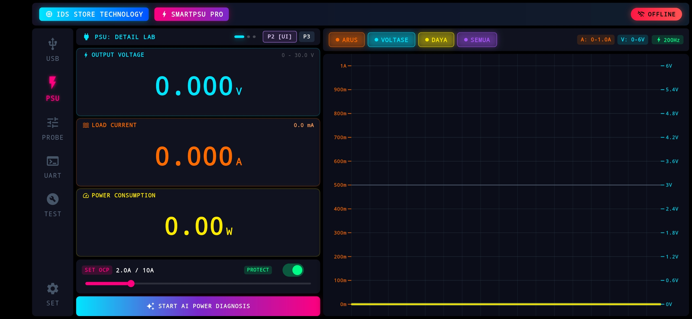
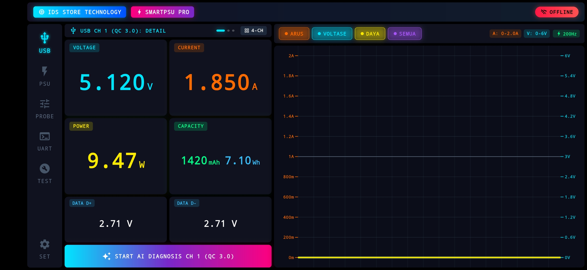
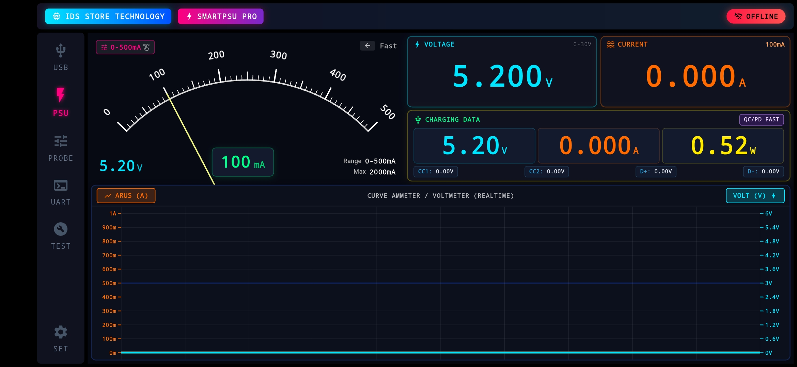

# ⚡ SMART PSU PRO v1.0.0
> **High-Precision IoT Power Supply & Multi-Channel Diagnostic Station**  
> **Author & Creator:** **Nurhadi**  
> Developed by **IDS STORE TECHNOLOGY**

---

## 📸 Interface & Dashboard Preview

<p align="center">
  
</p>

<p align="center">
  
  
</p>

---

## ✨ Fitur Utama

- **Real-Time Monitoring & Graphing**:
  - Ammeter Analog Gauge interaktif (0–500mA / range dinamis hingga 2000mA).
  - Dual-trace Realtime Curve (Grafik Arus vs Tegangan hingga refresh rate 200Hz).
- **Multi-Sensor Precision ADC**:
  - **ADS1115**: High-resolution 16-bit ADC untuk pembacaan voltase dan arus mikro yang akurat.
  - **INA3221**: Triple-channel high-side voltage & current monitor untuk jalur USB dan PSU.
- **Smart Protection & Controls**:
  - Over-Current Protection (OCP) dinamis yang dapat disetel lewat slider interaktif.
  - Fast output cut-off switch via hardware controller terintegrasi.
- **AI-Powered Diagnostics**:
  - Tombol aksi diagnostik daya (*Start AI Power Diagnosis*).
  - Analisis protokol pengisian daya (QC/PD Fast Charging & pantauan jalur data D+/D-).
- **Konektivitas IoT & Firmware Upgrade**:
  - Komunikasi telemetri kencang dan low-latency berbasis **UDP Socket**.
  - **ArduinoOTA Handler**: Pembaruan firmware secara nirkabel (Wireless/WiFi) tanpa perlu kabel serial.
  - Antarmuka ganda: Responsive Web Dashboard & Multiplatform Flutter Mobile App.

---

## 🛠️ Arsitektur Proyek

```text
smartpsu_v1.0.0/
├── docs/                   # Screenshot dashboard & media dokumentasi
│   ├── psu_h1.jpg          # Tampilan Gauge & Realtime Curve
│   ├── psu_h2.jpg          # Tampilan PSU Lab & OCP Slider
│   └── usb_h1.jpg          # Tampilan USB Channel & QC Diagnostics
├── smartpsu/               # Source Code Mobile App (Flutter)
├── ads1115.cpp / .h        # Driver ADC 16-bit
├── ina3221.cpp / .h        # Driver Multi-channel Current & Voltage Sensor
├── output_ctrl.cpp / .h    # Modul Proteksi & Saklar Output
├── udp_handler.cpp / .h    # High-speed UDP telemetry streaming
├── ota_handler.cpp / .h    # Over-The-Air wireless firmware updater
├── pin_config.h            # Konfigurasi Pin GPIO Hardware
├── smartpsu_web_dashboard.html # Web dashboard standalone
└── smartpsu_v1.0.0.ino     # Main entry point firmware
```

---

## 🚀 Panduan Penggunaan

### 1. Flash Firmware (ESP8266 Controller)
1. Buka folder `smartpsu_v1.0.0` di **Arduino IDE** atau **VS Code**.
2. Pastikan Board terpilih adalah **NodeMCU 1.0 (ESP-12E Module)** atau modul ESP8266 yang sesuai.
3. Periksa konfigurasi pin di [pin_config.h](pin_config.h).
4. Lakukan Compile dan Upload [smartpsu_v1.0.0.ino](smartpsu_v1.0.0.ino).

### 2. Menjalankan Aplikasi Mobile (Flutter)
Masuk ke direktori aplikasi mobile:
```bash
cd smartpsu
flutter pub get
flutter run
```

---

## 📄 Lisensi & Hak Cipta
Hak Cipta © 2026 **Nurhadi** (**IDS STORE TECHNOLOGY**). Seluruh hak cipta dilindungi.
